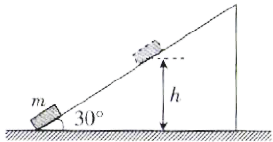

# Physics - 题目 2398

**ID**: b47e503fe51e4c048bb01f9671a6aa8f
**年级**: Grade 10
**难度**: Easy
**题型**: Calculation

## 题目
如图所示，质量 $m=1{\rm{k}}{\rm{g}}$ 的物块以某一速度从固定斜面底端冲上倾角 $θ=30{}^\circ $ 的斜面，物块在斜面上上升的最大高度 $h=1{\rm{m}}$ ，一定时间后物块返回斜面底端。​​​​​​​‌已知物块与斜面间的滑动摩擦力大小 $f=4{\rm{N}}$ ，取重力加速度大小 $g=10{\rm{m}}{\rm{/}}{\rm{s}}{^{2}}$ 。求：（1）物块刚冲上斜面底端时的动能 $E{{}_{{\rm{k}}}}$ ；（2）物块返回斜面底端时重力的瞬时功率P。

## 解答

1. （1）从开始到最高点由动能定理得 $-mgh-f\cdot \frac {h}{{\sin}θ}=0-E{{}_{{\rm{k}}}}$ ，解得 $E{{}_{{\rm{k}}}}=18{\rm{J}}$
2. （2）从最高点返回斜面底端过程由动能定理得 $mgh-f\cdot \frac {h}{{\sin}θ}=\frac {1}{2}mv{^{2}}$ ，此时重力的瞬时功率为 $P=mgv{\sin}θ$ ，联立解得 $P=10{\rm{W}}$

## 知识点

**中文**:
  - 动能定理的简单应用

**English**:
  - Simple Applications of Work-Energy Theorem

---
