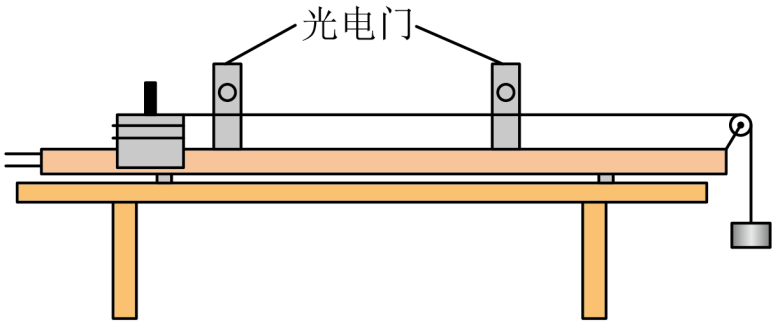

# Physics - 题目 1622

**ID**: cbebb0738e71440d98151d9f8efa8852
**年级**: Grade 10
**难度**: Easy
**题型**: Calculation

## 题目
如图所示，在水平气垫导轨上放置一质量为M的滑块，一不可伸长的轻绳绕过光滑轻质定滑轮，两端分别与滑块和一悬挂物相连接，滑块和滑轮间的轻绳与导轨平行。​​​​​​​‌现将滑块从静止释放，测得滑块先后通过两光电门时的速度大小分别为v_{1}和v_{2}，两光电门间的距离为l。（1）求绳对滑块的水平拉力。（2）求悬挂物的质量。（3）请推导绳的拉力F与滑块质量M、悬挂物质量m以及重力加速度g之间的函数关系。

## 解答

1. (1)对滑块，由运动学公式
2. $v{{}_{2}^{2}}-v{{}_{1}^{2}}=2al$
3. 可得滑块的加速度
4. $a=\frac {v{{}_{2}^{2}}-v{{}_{1}^{2}}}{2l}$
5. 由牛顿第二定律可得绳对滑块的水平拉力为
6. $F=Ma=\frac {M(v{{}_{2}^{2}}-v{{}_{1}^{2}})}{2l}$
7. (2)对悬挂物，由牛顿第二定律可得
8. $mg-F=ma$
9. 联立可解得悬挂物的质量
10. $m=\frac {M(v{{}_{2}^{2}}-v{{}_{1}^{2}})}{2gl-v{{}_{2}^{2}}+v{{}_{1}^{2}}}$ 。
11. (3)对滑块、悬挂物分别由牛顿第二定律可得
12. $F=Ma$
13. $mg-F=ma$
14. 联立可得
15. $F=\frac {Mmg}{M+m}$

## 知识点

**中文**:
  - 连接体问题（整体和隔离法）、临界问题

**English**:
  - Connected Bodies Problems (Whole/Isolation Method), Critical Problems

---
