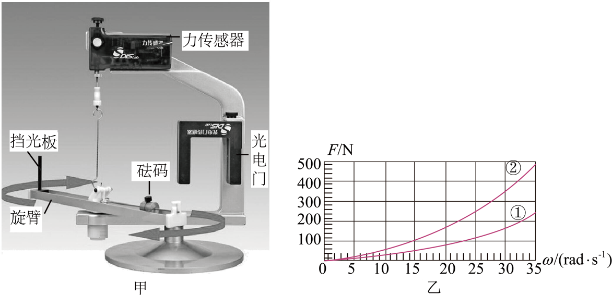

# Physics - 题目 790

**ID**: 29c75162d5904745be9b641bc08a8f30
**年级**: Grade 10
**难度**: Easy
**题型**: Experiment

## 题目
某兴趣小组用如图甲所示的装置与传感器结合，探究向心力大小的影响因素。​​​​​​​‌实验时用手拨动旋臂使它做圆周运动，力传感器和光电门固定在实验器材上，测量角速度和向心力。（1）电脑通过光电门测量挡光杆通过光电门的时间，并由挡光杆的宽度d、挡光杆通过光电门的时间 $Δt$ ，可得挡光杆转动的线速度 $v=$；若挡光杆做圆周运动的半径为r，可得砝码做圆周运动的角速度 $ω=$。（2）图乙中①、②两条曲线为相同半径、不同质量下向心力与角速度的关系图线，由图可知，曲线①对应的砝码质量（选填“大于”或“小于”）曲线②对应的砝码质量。

## 解答

1. （1）[1]挡光杆转动的线速度为
2. $v=\frac {d}{Δt}$
3. [2]由
4. $v=ωr$
5. 因砝码与挡光杆的角速度相同，故砝码做圆周运动的角速度为
6. $ω=\frac {d}{r\Delta t}$
7. （2）[3]由牛顿第二定律可得
8. $F=ma=mω{^{2}}r$
9. 若保持角速度和转动半径相同，可知质量大的物体需要的向心力大，所以曲线①对应的砝码质量小于曲线②对应的砝码质量。

## 知识点

**中文**:
  - 实验：探究向心力的大小

**English**:
  - Experiment: Investigating Magnitude of Centripetal Force

---
