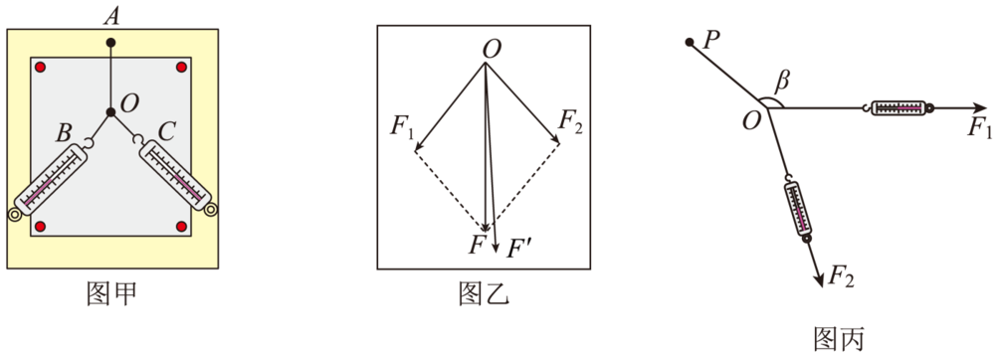

# Physics - 题目 1186

**ID**: 428ae8fa32d242efadbfb5ee98a6a8d2
**年级**: Grade 10
**难度**: Easy
**题型**: Experiment

## 题目
某同学做“验证力的平行四边形定则”的实验的装置如图甲所示，点为固定橡皮筋的图钉的位置，O点为橡皮筋与细绳的结点位置，OB和OC为细绳1图乙是根据实验结果在白纸上画出的力的图示情况。​​​​​​​‌（1）图乙中的F与 $F^{′}$ 两力中，方向一定沿AO方向的是；（2）关于此实验，下列描述正确的是。

## 解答

1. （1）[1]F是通过作图的方法得到的合力的理论值，而 $F{^{^{′}}}$ 是通过一个弹簧测力计沿AO方向拉橡皮筋,使结点到O点的拉力，方向一定沿AO方向的是 $F{^{^{′}}}$ ，由于误差的存在，F和 $F{^{^{′}}}$ 的方向并不重合。
2. （2）[2]A．两弹簧测力计的拉力的合力与橡皮筋的拉力大小相等，两弹簧测力计的拉力可比橡皮筋的拉力大，也可以比橡皮筋的拉力小，A错误；
3. B．两弹簧测力计的拉力与橡皮筋的拉力的合力为零，它们之间不是合力与分力的关系，B错误；
4. C．只要保证结点的位置相同，是否换成橡皮筋不影响实验结果，C错误；
5. D．两次拉橡皮筋时，为了使两次达到的效果相同橡皮筋与细绳的结点必须拉到同一位置O，D正确。
6. （3）[3]B．根据题意，对结点进行受力分析，如图所示
7. 
8. 由此可知减小 $F{{}_{1}}$ 的同时减小 $β$ 角可以实现题意要求，B正确；
9. C．同理对结点进行受力分析，如图所示
10. 
11. 由此可知增大 $F{{}_{1}}$ 的同时减小 $β$ 角也可以实现题意要求，C正确；
12. AD．根据力的平行四边形定则可知 $β$ 角不可能增大，AD错误。

## 知识点

**中文**:
  - 实验：探究两个互成角度的力的合成规律

**English**:
  - Experiment: Parallelogram Rule of Forces

---
