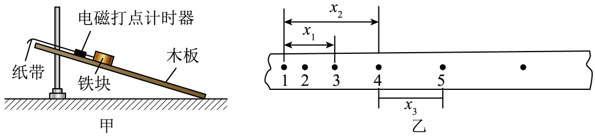

# Physics - 题目 833

**ID**: 7d86f38dd3de43b7b1b4f9779f85d769
**年级**: Grade 10
**难度**: Easy
**题型**: Experiment

## 题目
某同学利用如图甲所示装置测量铁块做直线运动的速度大小，回答下列问题：（1）电磁打点计时器连接的工作电源为；​​​​​​​‌

## 解答

1. （1）电磁打点计时器连接的工作电源为4~6V的交流电。
2. （2）实验时，应先接通电源，待打点稳定后，再释放铁块。
3. （3）电源的频率为50Hz，则打点的周期为 $T=\frac {1}{f}=0.02{\rm{s}}$ ，即每两点间的时间间隔 $T=0.02{\rm{s}}$ ，相邻计数点间还有四个点未画出，则相邻计数点的时间间隔 $t=5T=0.1{\rm{s}}$ ，乙图中第4点的速度大小 $v{{}_{4}}=\frac {x{{}_{35}}}{2t}=\frac {x{{}_{2}}+x{{}_{3}}-x{{}_{1}}}{10T}$ 。

## 知识点

**中文**:
  - 实验：探究小车速度随时间变化的规律

**English**:
  - Experiment: Investigating Cart Velocity vs Time

---
