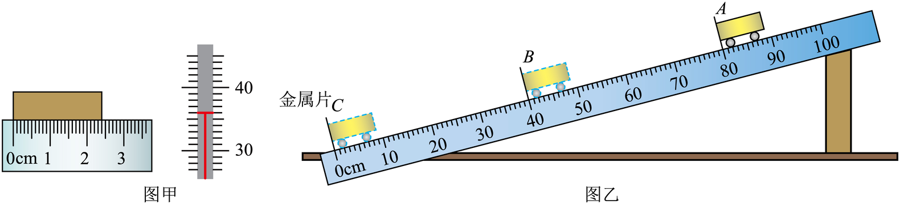

# Physics - 题目 1094

**ID**: bdd655ce45f1416da214cf990fdc16bb
**年级**: Grade 10
**难度**: Easy
**题型**: Experiment

## 题目
实验小组完成了以下实验：（1）如图甲所示，物体长度是cm；温度计示数是${}\degree {\rm{C}}$ 。​​​​​​​‌（2）如图乙所示，明明测量小车下滑的平均速度，小车从斜面的 $\mathrm{A}$ 点由静止开始下滑，如果测得小车到达 $C$ 点所用的时间为2s，则 $AC$ 段的平均速度 $v{{}_{AC}}=$m/s。

## 解答

1. （1）刻度尺分度值为0.1cm，读数为2.40cm；
2. 温度计示数为 ${\rm 36}{}\degree {\rm{C}}$ 。
3. （2）根据平均速度的计算公式可知 $v{{}_{AC}}=\frac {x{{}_{AC}}}{t}=\frac {80}{2}\times 0.01{\rm{m}}{\rm{/}}{\rm{s}}=0.4{\rm{m}}{\rm{/}}{\rm{s}}$

## 知识点

**中文**:
  - 力学

**English**:
  - Mechanics

---
