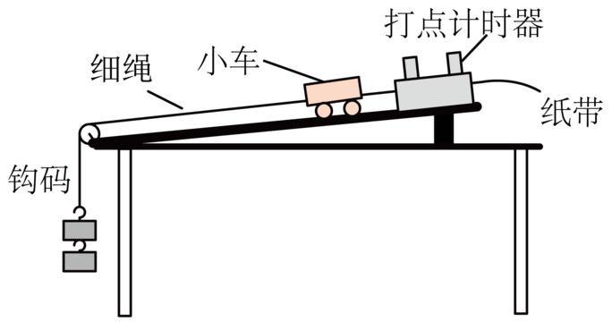

# Physics - 题目 1345

**ID**: d872a6625ac0431fab9f9de4c24bbfde
**年级**: Grade 10
**难度**: Easy
**题型**: Experiment

## 题目
某同学用图示装置探究加速度与力的关系。​​​​​​​‌(1)为平衡小车受到的阻力，需要调节木板倾角，使小车在不挂钩码时运动，并打出纸带进行检验，下图中的三条纸带能表明平衡阻力恰当的是（      ）

## 解答

1. （1）为平衡小车受到的阻力，需要调节木板倾角，使小车在不挂钩码时运动，使得小车能匀速运动，即打出的纸带应该点迹均匀，由图可知图中的三条纸带能表明平衡阻力恰当的是B。
2. （2）每相邻两个计数点间还有4个计时点未画出，可知T=0.1s，则加速度 $a=\frac {x{{}_{CE}}-x{{}_{AC}}}{4T{^{2}}}=\frac {(17.86-7.92-7.92)\times 10{^{-2}}}{4\times 0.1{^{2}}}{\rm{m}}{\rm{/}}{\rm{s}}{^{2}}=0.51{\rm{m}}{\rm{/}}{\rm{s}}{^{2}}$
3. （3）将一个可以直接测出绳子拉力的传感器安装在小车上，因传感器能测量小车受的拉力，则实验中钩码的质量不需要满足远小于小车的质量。
4. （4）若实验时交变电流的频率f=46Hz，打点周期偏大，实验者仍按50Hz的频率计算，则测得的加速度数值大于真实值。

## 知识点

**中文**:
  - 实验：探究加速度与力、质量的关系

**English**:
  - Experiment: Acceleration vs Force and Mass (Newton's 2nd Law)

---
