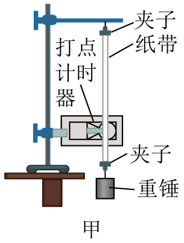

# Physics - 题目 999

**ID**: d9f46f86e86c4dc9b13456f8fb296121
**年级**: Grade 10
**难度**: Easy
**题型**: Experiment

## 题目
学习了重力加速度相关知识后，同学们非常想知道我们重庆地区重力加速度的真实数值是否和理论数值相同，该实验操作简单易行，在教室内就可以完成。​​​​​​​‌高一年级某班小字同学用张老师提供的实验器材采用如图甲所示的实验装置测量自由落体的加速度。重锤从高处由静止开始下落，重锤上拖着的纸带通过打点计时器，打出一系列的点，对纸带上的点迹进行测量，即可求出当地自由落体加速度。(1)实验过程中除图甲所示的实验器材外，还必须使用的器材有电源和；（在“秒表”或“刻度尺”中选填）(2)下面列举出该实验的几个操作步骤，其中操作正确的一个步骤是；

## 解答

1. （1）打点计时器需要连接交流电源，需要用刻度尺测量纸带上计数点之间的距离；通过打点计时器可以知道计数点的时间间隔，所以不需要秒表。
2. （2）A．按照图甲安装好实验器材并连接好交流电源，A错误；
3. B．为了减小空气阻力和摩擦阻力的影响，应选择质量大、体积小的重锤，B正确；
4. C．实验的目的是求解重力加速度，如果用了公式 $v{^{2}}=2gh$ 相当于知道了确定了加速度的值失去实验的意义，C错误。
5. 选B。
6. （3）根据逐差法可得重锤下落的加速度为
7. $g=\frac {x{{}_{DG}}-x{{}_{AD}}}{9T{^{2}}}=\frac {\left ({1.80+2.18+2.42-0.59-0.96-1.35}\right )\times 10{^{-2}}}{9\times 0.02{^{2}}}{\rm{m}}{\rm{/}}{\rm{s}}{^{{{2}}}}\approx 9.72{\rm{m}}{\rm{/}}{\rm{s}}{^{{{2}}}}$

## 知识点

**中文**:
  - 自由落体相关实验

**English**:
  - Experiments Related to Free Fall

---
