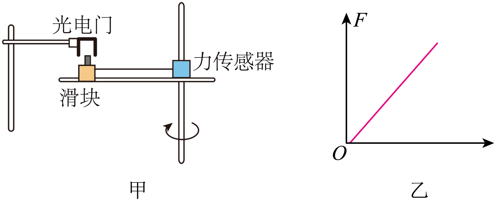

# Physics - 题目 881

**ID**: e3bd01d3b6c94870b6afbf7a787ae08a
**年级**: Grade 10
**难度**: Easy
**题型**: Experiment

## 题目
为“探究向心力大小与角速度的关系”，某实验小组通过如图甲所示的装置进行实验。​​​​​​​‌滑块套在水平杆上，可随水平杆一起绕竖直杆做匀速圆周运动，力传感器通过细绳连接滑块，可测绳上拉力大小。滑块上固定一遮光片，宽度为d，光电门可以记录遮光片通过的时间，测出滑块中心到竖直杆的距离为l。实验过程中细绳始终被拉直。滑块随杆转动做匀速圆周运动时，每经过光电门一次，力传感器和光电门就同时获得一组拉力F和遮光时间t，重复做多组实验并得出数据。（1）滑块的角速度ω=（用d、l、t表示）（2）图乙所示为根据拉力F和遮光时间t的数据所做的关系图像，图像的横轴应该是。

## 解答

1. （1）滑块经过光电门时的速度为 $v=\frac {d}{t}$
2. 根据 $v=ωl$ ，可得滑块的角速度为 $ω=\frac {d}{tl}$
3. （2）滑块做匀速圆周运动，由细绳拉力向心力，则有可得 $F=mω{^{2}}l$
4. 可得 $F=\frac {md{^{2}}}{l}\cdot \frac {1}{t{^{2}}}$
5. 则图乙所示为根据拉力F和遮光时间t的数据所做的关系图像，图像的横轴应该是 $\frac {1}{t{^{2}}}$ 。

## 知识点

**中文**:
  - 实验：探究向心力的大小

**English**:
  - Experiment: Investigating Magnitude of Centripetal Force

---
