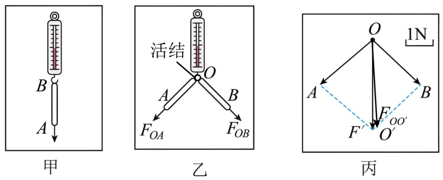

# Physics - 题目 1683

**ID**: f6cb23d216d24ec484170afbaebe3b69
**年级**: Grade 10
**难度**: Easy
**题型**: Experiment

## 题目
某实验小组欲验证力的平行四边形定则。​​​​​​​‌实验步骤如下：①将弹簧秤固定在贴有白纸的竖直木板上，使其轴线沿竖直方向；②如图甲所示，将环形橡皮筋一端挂在弹簧秤的秤钩上，另一端用圆珠笔尖竖直向下拉，直到弹簧秤的示数为某一设定值，将橡皮筋两端的位置标记为 $O{{}_{1}}、O{{}_{2}}$ ，记录弹簧秤的示数 $F$ ，测量并记录 $O{{}_{1}}、O{{}_{2}}$ 间的距离（即橡皮筋的长度 $l$ ）。每次将弹簧秤的示数改变 $1.00{\rm{N}}$ ，测出对应的 $l$ ，部分数据如下表所示：$F/{\rm{N}}$01.002.003.004.005.006.00。。。12.0013.0014.00$l/{\rm{c}}{\rm{m}}$$l{{}_{0}}$11.0012.0013.0014.0015.0016.00。。。22.0023.0024.00③找出步骤②中 $F=7.00{\rm{N}}$ 时橡皮筋两端的位置，重新标记为 $O$ 、 $O^{′}$ （橡皮筋上端为 $O$ ，下端为 $O^{′}$ ），此时橡皮筋的拉力记为 $F{{}_{OO^{′}}}$ ；④在秤钩上涂抹少许润滑油，将这根橡皮筋搭在秤钩上，如图乙所示，用两圆珠笔尖成适当角度同时拉橡皮筋的两端，使秤钩的下端到达 $O$ 点，将两笔尖的位置标记为 $A、\,B$ ，橡皮筋OA段的长度记为 $l{{}_{1}},OB$ 段的长度记为 $l{{}_{2}}$ ；⑤根据给出的标度，作出 $F{{}_{OA}}$ 和 $F{{}_{OB}}$ 的合力 $F^{′}$ ，如图丙所示。（1）本实验主要采用的科学方法是

## 解答

1. （1）本实验主要采用的科学方法是等效替代法，故选C；
2. （2）根据胡克定律，有 $ΔF=kΔx$ ，代入表格中第二组和第三组数据，有 $\left ({2.00-1.00}\right ){\rm{N}}=k\left ({12.00-11.00}\right )\times 10{^{-2}}{\rm{m}}$ ，解得 $k=100{\rm{N}}{\rm{/}}{\rm{m}}$ ，同理，再代入第一组和第二组数据，得 $\left ({1.00-0}\right ){\rm{N}}=100{\rm{N}}{\rm{/}}{\rm{m}}\left ({11.00-l{{}_{0}}}\right )\times 10{^{-2}}{\rm{m}}$ ，可得 $l{{}_{0}}=10.00{\rm{c}}{\rm{m}}$ ，橡皮筋上的弹力 $F{{}_{OA}}=F{{}_{OB}}=k(l{{}_{1}}+l{{}_{2}}-l{{}_{0}})=13.00{\rm{N}}$ 。
3. （3）在两个力的作用效果和一个力的作用效果相同的情况下，由平行四边形求得的力 $F^{′}$ 和一个力 $F{{}_{OO^{′}}}$ 作用时比较，即可验证力的平行四边形定则。

## 知识点

**中文**:
  - 实验：探究两个互成角度的力的合成规律

**English**:
  - Experiment: Parallelogram Rule of Forces

---
