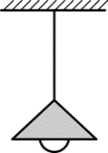

# Physics - 题目 2940

**ID**: 98f483fbcace4dae951448a0e4bfdcba
**年级**: Grade 10
**难度**: Easy
**题型**: 本题共13小题，每小题3分，共39分。在每小题给出的四个选项中，只有一个选项是符合题目要求的。把答案用2B铅笔填涂在答题卡上。

## 题目
如图所示，电灯吊在天花板上。​​​​​​​‌下面属于一对作用力与反作用力的是（      ）

## 解答

1. 一对作用力与反作用力是指两个物体相互之间的力，施力物体同时也是受力物体。灯受到的重力，施力物体是地球，受力物体是灯，灯对悬线的拉力，施力物体是灯，受力物体是悬线，故A错误；灯受到的重力，施力物体是地球，受力物体是灯，悬线对灯的拉力，施力物体是悬线，受力物体是灯，故B错误；灯对悬线的拉力，施力物体是灯，受力物体是悬线，悬线对灯的拉力，施力物体是悬线，受力物体是灯，故C正确；灯受到的重力，施力物体是地球，受力物体是灯，悬线对天花板的拉力，施力物体是悬线，受力物体是天花板，故D错误。

## 知识点

**中文**:
  - 作用力与反作用力

**English**:
  - Action and Reaction Forces

---
