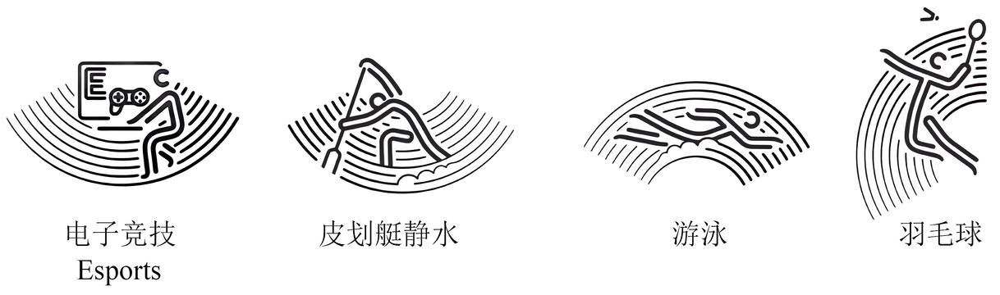

# Physics - 题目 1408

**ID**: 0f1937ed4d1249c98601f55c9ece9b3c
**年级**: Grade 10
**难度**: Easy
**题型**: Multiple-choice

## 题目
下列有关比赛项目说法正确的是（      ）​​​​​​​‌

## 解答

1. “15分钟”指的是时间间隔，A错误；研究皮划艇比赛中皮划艇运动过程中的船体姿态时，皮划艇不可看成一个质点，B正确；两百米游泳比赛（游泳赛道长100m）中运动员的位移为0，则平均速度大小为0，C错误；羽毛球比赛中击球后，羽毛球在空中继续向前运动时，没有受到推力作用，D错误。

## 知识点

**中文**:
  - 位置、位移与路程
  - 质点

**English**:
  - Position, Displacement, and Distance
  - Mass Point (Particle)

---
