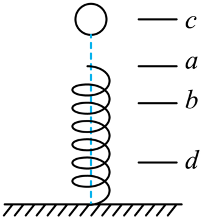

# Physics - 题目 1329

**ID**: 1609493b2c8e488ca6c726d1f813f01b
**年级**: Grade 10
**难度**: Easy
**题型**: Multiple-choice

## 题目
如图所示，一轻弹簧竖直放置，下端固定在水平面上，上端处于a位置。​​​​​​​‌现让一小球从高于a位置的c点沿弹簧中轴线自由下落，弹簧被小球压缩至最低位置d，其中经过位置b时弹力等于重力。不计空气阻力，关于小球下落运动过程，以下说法中正确的是（      ）

## 解答

1. A．c至a做自由落体运动，即做匀加速运动，经过位置b时弹力等于重力，则a至b阶段重力大于弹簧弹力，仍然做加速运动，A错误；
2. B．如果小球是从a位置释放的，则会做简谐运动，根据对称性，到最低点时加速度与刚释放时的加速度等大反向，对应弹簧弹力等于小球重力的2倍，如果重球释放点比a点高，就会把弹簧压得更低，弹簧弹力必定大于小球重力的2倍，B错误；
3. C．下落过程中小球由c至b减小的重力势能转化为在b处的动能和弹簧的弹性势能，C错误；
4. D．根据能量守恒，弹簧由a至d增加的弹性势能等于小球由c至d减小的重力势能，D正确。选D。

## 知识点

**中文**:
  - 弹簧问题中机械能守恒定律的应用

**English**:
  - Spring Problems

---
