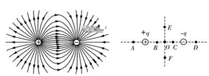

# Physics - 题目 1966

**ID**: 205167036b644062ac680e03b125ec66
**年级**: Grade 10
**难度**: Easy
**题型**: Multiple-choice

## 题目
用电场线能很直观很方便地比较电场中各点的电场强弱．如图，左边是等量异种点电荷形成电场的电场线，右边是场中的一些点：O是电荷连线的中点，E、F是连线中垂线上相对O对称的两点，B、C和A、D也相对O对称，则下列认识不正确的是​​​​​​​‌

## 解答

1. 根据对称性看出，A、D两处电场线疏密程度相同，则A、D两点场强大小相同．由图看出，A、D两点场强方向相同，故A说法错误；根据对称性看出，B、C两处电场线疏密程度相同，则B、C两点场强大小相同．这两点场强的方向均由B→C，方向相同，故B说法正确；由图看出，E、F两点中，电场线疏密程度相同，两点场强方向相同，故C说法正确；由图看出，电场线先变密，再变疏，所以场强先增大后减小，故D说法正确．所以选A．

## 知识点

**中文**:
  - 几种常见的电场
  - 点电荷的场强

**English**:
  - Several Common Electric Fields
  - Field Strength of Point Charge

---
