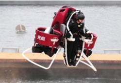

# Physics - 题目 1583

**ID**: 2aa5d3d43a4e4c0eb507d56ca9369720
**年级**: Grade 10
**难度**: Easy
**题型**: Multiple-choice

## 题目
载人飞行包是一个单人低空飞行装置，如图所示，其发动机使用汽油作为燃料提供动力，可以垂直起降也可以快速前进，若飞行包（包括人）在竖直方向上匀速上升的过程中（空气阻力不可忽略），下列说法正确的是​​​​​​​‌

## 解答

1. A．飞行包（包括人）在竖直匀速上升的过程中，发动机的动力向上，则发动机对飞行包做正功，A错误；
2. B．高度上升，飞行包的重力做负功，B错误；
3. C．飞行包（包括人）在竖直方向上匀速上升，飞行包的动能不变，选C正确；
4. D．飞行包在上升过程中动能不变，重力势能变大，机械能变大，D错误。选C。

## 知识点

**中文**:
  - 功能原理、能量守恒与曲线运动的综合

**English**:
  - Energy Conservation in Curvilinear Motion

---
