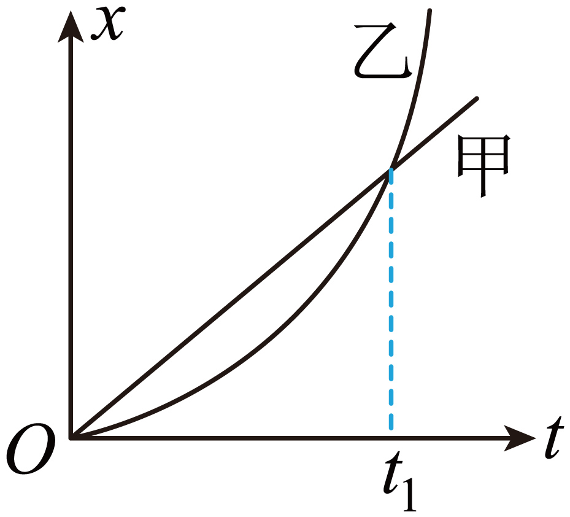

# Physics - 题目 2765

**ID**: 30b1037eb1834333b110432f3147f703
**年级**: Grade 10
**难度**: Easy
**题型**: Multiple-choice

## 题目
甲、乙两车某时刻由同一地点沿同一方向开始做直线运动，若以该时刻作为计时起点，得到两车的 $x-t$ 图像，如图所示，则下列说法正确的是（      ）​​​​​​​‌

## 解答

1. $t{{}_{1}}$ 时刻前，甲车位移大于乙车位移，说明甲车在前面乙车在后面， $t{{}_{1}}$ 时刻两车的位置相同，则 $t{{}_{1}}$ 时刻乙车从后面追上甲车，A正确，B错误； $x-t$ 图像的斜率表示速度， $t{{}_{1}}$ 时刻乙车图像的斜率大，速度大，C项错误；0到 $t{{}_{1}}$ 时间内，两车初、末位置相同，位移相同，乙车的平均速度等于甲车的平均速度，D项错误。

## 知识点

**中文**:
  - x-t图像及其应用

**English**:
  - x-t Graphs and Applications

---
