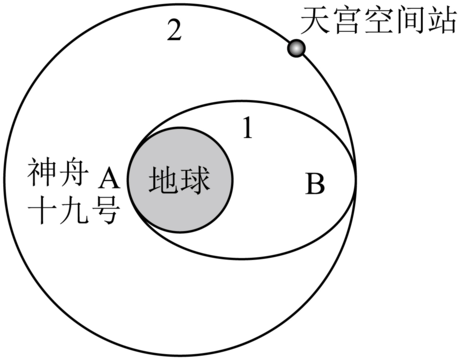

# Physics - 题目 2481

**ID**: 4610606ee2e44977be8fd7fa989e6daa
**年级**: Grade 10
**难度**: Easy
**题型**: Multiple-choice

## 题目
2024年10月30日，搭载神舟十九号载人飞船的火箭成功发射升空，6名中国航天员在太空顺利会师。​​​​​​​‌如图是飞船发射至对接的原理图，载人飞船进入预定轨道1后，与轨道2的天宫空间站完成自主快速交会对接，以下说法正确的是（      ）

## 解答

1. 过A点可以作出近地卫星的圆轨道，该轨道上的速度等于第一宇宙速度，由近地圆轨道变轨到轨道1，需要再A点加速，可知，飞船在轨道1近地点A的线速度大小大于第一宇宙速度，A错误；11.2km/s为第二宇宙速度，飞船在轨道1上仍然在地球束缚之下，可知，飞船从地面发射进入轨道1的速度不能够超过11.2km/s，B错误；船先进入轨道2，加速后，速度增大，万有引力不足以提供圆周运动的向心力，飞船将做离心运动，不能够完成对接，C错误；由于天宫空间站的运行的轨道半径大于轨道1的半长轴，根据开普勒第三定律可知，天宫空间站的运行周期大于飞船在轨道1的运行周期，D正确。

## 知识点

**中文**:
  - 卫星变轨与对接问题

**English**:
  - Satellite Orbit Change and Docking

---
