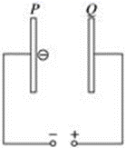

# Physics - 题目 914

**ID**: 46e43ad2613849509528dd20cf258ddb
**年级**: Grade 10
**难度**: Easy
**题型**: Multiple-choice

## 题目
如图所示，P和Q为两平行金属板，两极板间电压为U，在P板附近有一电子由静止开始向Q板运动，关于电子到达Q板时的速率，下列说法正确的是（      ）​​​​​​​‌

## 解答

1. A．粒子运动过程只有电场力做功，根据动能定理：
2. $eU=\frac {1}{2}mv{^{2}}$
3. 两板间距离越大，根据：
4. $E=\frac {U}{d}$
5. 可知场强越小，根据：
6. $d=\frac {1}{2}\cdot \frac {qE}{m}\cdot t{^{2}}$
7. 可知加速时间越长，因为加速电压不变，所以最后的末速度大小不变，A错误；
8. B．两板间距离越小，场强越大，加速度越大，因为加速电压不变，所以最后的末速度大小不变，B错误；
9. CD．根据动能定理：
10. $eU=\frac {1}{2}mv{^{2}}$
11. 虽然极板间距发生变化，但是电压不变，所以最后的末速度大小不变，C正确，D错误。
12. 故选C。

## 知识点

**中文**:
  - 带电粒子在匀强电场中的运动

**English**:
  - Motion in Uniform Electric Field

---
