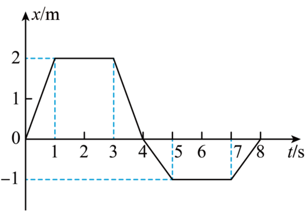

# Physics - 题目 1573

**ID**: 5351689d98424cebbd575b1c34823063
**年级**: Grade 10
**难度**: Easy
**题型**: Multiple-choice

## 题目
质点沿直线运动，其位移-时间图像如图所示，关于质点的运动，下列说法中正确的是（      ）​​​​​​​‌

## 解答

1. AB．图线的斜率表示速度，在0～1s内，质点向x轴正方向做匀速直线运动，质点速度大小为 $v=\frac {2-0}{1-0}{\rm{m}}{\rm{/}}{\rm{s}}=2{\rm{m}}{\rm{/}}{\rm{s}}$ ，质点加速度为 $a=0{\rm ，AB}$ 错误；
2. C．4～5s内，质点向x轴负方向做匀速直线运动，C正确
3. D．7～8s内，质点向x轴正方向做匀速直线运动，D错误。选C。

## 知识点

**中文**:
  - x-t图像及其应用

**English**:
  - x-t Graphs and Applications

---
