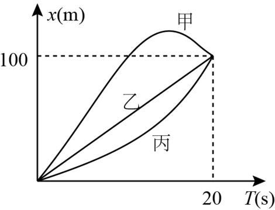

# Physics - 题目 1879

**ID**: 5af9b8dd269b4318918ec822d0ca5c6a
**年级**: Grade 10
**难度**: Easy
**题型**: Multiple-choice

## 题目
甲、乙、丙三个物体同时、同地出发做直线运动，它们的位移﹣时间图像如图所示，则在此过程中，下列说法中正确的是（      ）​​​​​​​‌

## 解答

1. AD．三者都做直线运动，由于甲物体有反向运动过程，故甲物体的路程要大，而乙丙均只有单向运动，路程相等，平均速率等于路程除以时间，所以甲的平均速率最大，故AD错误；
2. B．x-t图象的斜率表示速度，根据图象可知，只有乙做匀速直线运动，甲和丙的速度都在变化，不是匀速直线运动，故B错误；
3. C．由图可知，三物体最终位移相等，用时相等，故平均速度相等，故C正确；
4. 故选C。

## 知识点

**中文**:
  - x-t图像及其应用
  - 平均速度和瞬时速度、平均速率

**English**:
  - x-t Graphs and Applications
  - Average Velocity, Instantaneous Velocity, and Average Speed

---
