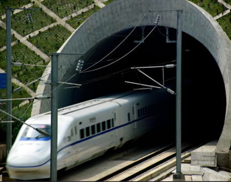

# Physics - 题目 2457

**ID**: 5d25eff2e82e43938c823cd74d051a71
**年级**: Grade 10
**难度**: Easy
**题型**: Multiple-choice

## 题目
如图，长100m的列车匀加速通过长1000m的平直隧道，车头刚进隧道时速度是10m/s，车尾刚出隧道时速度是12m/s，则列车通过隧道所用的时间是（      ）​​​​​​​‌

## 解答

1. 列车通过隧道走过的位移为 $s=1000{\rm{m}}+100{\rm{m}}=1100{\rm{m}}$ ，设所用时间为t由： $s={\overline{v}}t$ ， ${\overline{v}}=\frac {12+10}{2}{\rm{m}}{\rm{/}}{\rm{s}}{\rm{=}}{{1}}{{1}}{\rm{m}}{\rm{/}}{\rm{s}}$ ，解得 $t=100{\rm{s}}$ ，选C。

## 知识点

**中文**:
  - 平均速度公式的应用

**English**:
  - Applications of Average Velocity Formula

---
