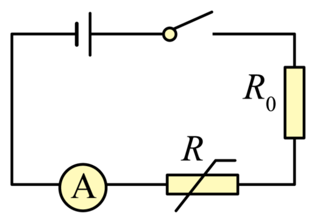

# Physics - 题目 1641

**ID**: 61a170b3cf514bdbb921264039ee05a2
**年级**: Grade 10
**难度**: Easy
**题型**: Multiple-choice

## 题目
利用如图所示电路可以测量电源的电动势E和内阻r，R为电阻箱，R_{0}为定值电阻。​​​​​​​‌闭合开关，当R取不同阻值时，电流表对应有不同读数I，多次改变电阻箱的阻值，所得到的 $\frac {1}{I}-R$ 图像应为（      ）

## 解答

1. 由闭合电路欧姆定律得
2. $E=I(r+R{{}_{0}}+R)$
3. 解得
4. $\frac {1}{I}=\frac {r+R{{}_{0}}}{E}+\frac {1}{E}R$
5. 可知 $\frac {1}{I}-R$ 图线是一条不过原点的 $\frac {1}{I}$ 随 $R$ 增加的直线。故A正确，BCD错误。
6. 故选A。

## 知识点

**中文**:
  - 实验：电池电动势和内阻的测量—安阻法测量电源电动势与内阻
  - 闭合电路的欧姆定律
  - 电源的电动势、内阻
  - 常见的电路元器件
  - 闭合电路的欧姆定律及其应用
  - 路端电压与负载的关系
  - 闭合电路输出功率与效率
  - 电路的动态分析问题
  - 非纯电阻电路的相关计算
  - 闭合电路故障分析

**English**:
  - A-R Method for EMF and Internal Resistance
  - Ohm's Law for Closed Circuits
  - EMF and Internal Resistance of Power Source
  - Common Circuit Components
  - Ohm's Law for Closed Circuits and Applications
  - Terminal Voltage vs Load
  - Output Power and Efficiency of Closed Circuits
  - Dynamic Circuit Analysis
  - Calculations for Non-Pure Resistive Circuits
  - Fault Analysis in Closed Circuits

---
