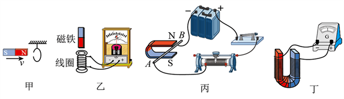

# Physics - 题目 2437

**ID**: 69dd74dff9a34928b9e2a745fb36aa8d
**年级**: Grade 10
**难度**: Easy
**题型**: Multiple-choice

## 题目
在物理学史上，奥斯特首先发现电流周围存在磁场。​​​​​​​‌随后，物理学家提出“磁生电”的设想。很多科学家为证实这种设想进行了大量研究。下列实验中可以产生感应电流的是（      ）

## 解答

1. A．甲图中，条形磁铁向金属环运动过程，穿过金属环的磁通量有变化，但由于金属环不闭合，不能能产生感应电流，选项A错误；
2. B．乙图中，条形磁铁插入线圈的过程中，线圈中的磁通量发生变化，会产生感应电流，选项B正确；
3. C．丙图中，金属棒通电后受到安培力，在安培力作用下开始运动，和感应电流无关，选项C错误；
4. D．丁图中，既没有导体切割磁感线，也没有磁通量的变化，故不产生感应电流，选项D错误。
5. 故选B。

## 知识点

**中文**:
  - 产生感应电流的条件

**English**:
  - Conditions for Induced Current

---
