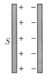

# Physics - 题目 343

**ID**: 6a696b032b19455da8f0ce6d6925a231
**年级**: Grade 10
**难度**: Easy
**题型**: Multiple-choice

## 题目
已知均匀带电的无穷大平面在真空中激发电场的场强大小为 $\frac {σ}{2\varepsilon {{}_{0}}}$ ，其中 $σ$ 为平面上单位面积所带的电荷量， $\varepsilon {{}_{0}}$ 为常量。​​​​​​​‌如图所示的平行板电容器，极板正对面积为 $S$ ，间距为 $d$ ，两极板间为真空，不计边缘效应时，极板可看作无穷大导体板，则该电容器的电容可表示为（      ）

## 解答

1. 设每块极板上带电荷量为 $Q$ ，则每块极板上单位面积所带的电荷量为
2. $σ=\frac {Q}{S}$
3. 每块极板产生的电场强度为
4. $E=\frac {σ}{2\varepsilon {{}_{0}}}$
5. 可知两极板间的电场强度为
6. $E^{′}=2E=\frac {Q}{\varepsilon {{}_{0}}S}$
7. 两极板间的电压
8. $U=E^{′}d=\frac {Q}{\varepsilon {{}_{0}}S}d$
9. 电容器的电容
10. $C=\frac {Q}{U}=\frac {\varepsilon {{}_{0}}S}{d}$
11. 故选B。

## 知识点

**中文**:
  - 匀强电场中电势差与电场强度的关系
  - 电容器与电容

**English**:
  - U=Ed in Uniform Electric Field
  - Capacitors and Capacitance

---
