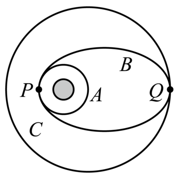

# Physics - 题目 1938

**ID**: 7075275f5ca142a9a680cc28c5b777c5
**年级**: Grade 10
**难度**: Easy
**题型**: Multiple-choice

## 题目
如图所示，飞船在地面指挥控制中心的控制下，由近地点圆形轨道A，经椭圆轨道B转变到远地点的圆轨道C。​​​​​​​‌轨道A与轨道B相切于P点，轨道B与轨道C相切于Q点，以下说法正确的是（      ）

## 解答

1. A：卫星在轨道B上由P向Q运动的过程中，引力做负功，卫星的动能越来越小，即速度越来越小，A错误；
2. B：卫星在P点时由万有引力产生加速度，在同一点引力产生的加速度相同，与卫星在哪个轨道无关，即卫星在轨道B上经过P点的加速度与在轨道A上经过P点的加速度是相等的，B正确；
3. C：卫星在轨道A和C上分别做圆周运动，根据 $v=\sqrt {\frac {GM}{r}}$ ，可知卫星在轨道C的速率小于卫星在轨道A的速率，C错误；
4. D：根据万有引力公式 $F=G\frac {Mm}{r{^{2}}}$ ，可知卫星在Q点时的引力小于经过P点时受到的引力，即卫星在轨道B上经过Q点时向心力小于经过P点时向心力，D错误。选B。

## 知识点

**中文**:
  - 卫星变轨与对接问题

**English**:
  - Satellite Orbit Change and Docking

---
