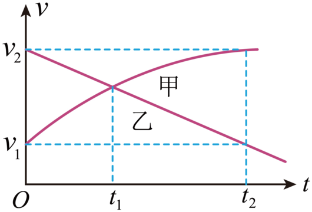

# Physics - 题目 1428

**ID**: 99200d8b2d874c1f8f563da036b276e5
**年级**: Grade 10
**难度**: Easy
**题型**: Multiple-choice

## 题目
甲、乙两辆汽车分别在同一平直公路的两条车道上同向行驶， $t=0$ 时刻它们恰好经过同一路标。​​​​​​​‌此后两辆车的 $v-t$ 图像如图所示。根据图像，下列判断正确的是（      ）

## 解答

1. A．图像面积表示位移，所以在t_{1}时刻，甲车在乙车后面。A错误；
2. CD．在0~t_{2}时间内，由图像可知，甲车位移大于乙车，所以甲车在某个时刻追上了乙车，且根据 $\bar v=\frac {x}{t}$ 可知甲车的平均速度比乙车大，C正确，D错误；
3. B．图像的斜率表示加速度，所以由图可知，t_{2}时刻甲车的加速度大小小于乙车的加速度大小，B错误，选C。

## 知识点

**中文**:
  - v-t图像及其应用

**English**:
  - v-t Graphs and Applications

---
