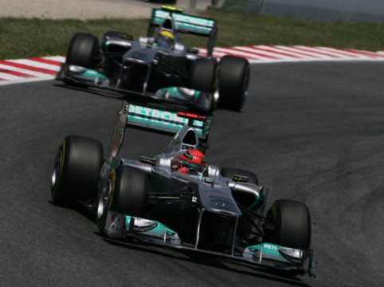

# Physics - 题目 1709

**ID**: 9d73785aa1f347629d0c66217d92782c
**年级**: Grade 10
**难度**: Easy
**题型**: Multiple-choice

## 题目
3月18日，2022赛季世界一级方程式锦标赛（F1）揭幕战巴林站拉开帷幕，中国车手周冠宇迎来自己在F1赛场的首秀。​​​​​​​‌如图所示为周冠宇弯道超车的情景，则下列关于周冠宇赛车的说法正确的是（      ）

## 解答

1. 匀变速运动加速度不变，可知周冠宇赛车一定不做匀变速运动，AD错误；周冠宇赛车做曲线运动，速度方向与合外力方向不在同一直线上，速度方向与加速度方向不在同一直线上，B错误，C正确。

## 知识点

**中文**:
  - 曲线运动中运动轨迹与合外力、速度方向之间的关系

**English**:
  - Relationship between Trajectory, Net Force, and Velocity Direction

---
