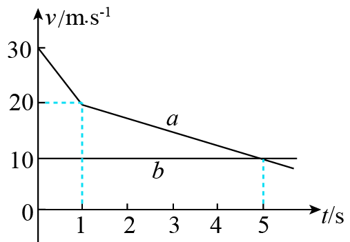

# Physics - 题目 367

**ID**: 9dc27964649446d89809801e92d1c768
**年级**: Grade 10
**难度**: Easy
**题型**: Multiple-choice

## 题目
近年来，我国一些地区出现了雾霾天气，影响了人们的正常生活。​​​​​​​‌在一雾霾天，某人驾驶一辆小汽车以30m/s的速度行驶在高速公路上，突然发现正前方有一辆大卡车正以10 m/s的速度同方向匀速行驶，小汽车紧急刹车，已知小汽车刚刹车时与大卡车相距40m，并开始计时，得到小汽车和大卡车的v—t图像分别如图中a、b所示，以下说法正确的是（      ）

## 解答

1. 小车司机从发现大卡车到速度与卡车速度相等所用时间相等，在这段时间内，卡车匀速直线运动，小车分两段都做匀减速直线运动，5s时速度相等，大卡车的位移
2. $x=vt=50{\rm{m}}$
3. 小车的位移
4. $x^{′}=x{{}_{1}}+x{{}_{2}}=\frac {\left ({20+30}\right )}{2}\times 1{\rm{m}}+\frac {\left ({20+10}\right )}{2}\times 4{\rm{m}}=85{\rm{m}}$
5. 由于
6. $x^{′}-x=35{\rm{m}}<40{\rm{m}}$
7. 故两车没有追尾，且在t=5s时，两车相距最近。
8. 故选D。

## 知识点

**中文**:
  - 刹车问题

**English**:
  - Braking Problems

---
