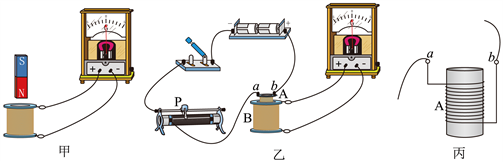

# Physics - 题目 268

**ID**: a30ef054977b42dfb6bf79568ebc8d91
**年级**: Grade 10
**难度**: Easy
**题型**: Multiple-choice

## 题目
如图甲所示，当条形磁铁向下插入螺线管时，灵敏电流计的指针向右偏。​​​​​​​‌如图乙所示把磁铁换为螺线管A，螺线管A的绕线方式如图丙所示。下列措施中使灵敏电流计的指针向左偏的是（      ）

## 解答

1. 由图甲可知当穿过线圈向下的磁通量增加时，灵敏电流计的指针向右偏，若使灵敏电流计的指针向左偏，则需穿过线圈向下的磁通量减少或穿过线圈向上的磁通量增加。图乙中，闭合开关后螺线管A向下移动、闭合开关瞬间或闭合开关后向左移动滑片P，穿过线圈向下的磁通量增加；闭合开关后向右移动滑片P，穿过线圈向下的磁通量减少，灵敏电流计指针向左偏，故C正确，A、B、D错误。
2. 故选C。

## 知识点

**中文**:
  - 产生感应电流的条件

**English**:
  - Conditions for Induced Current

---
