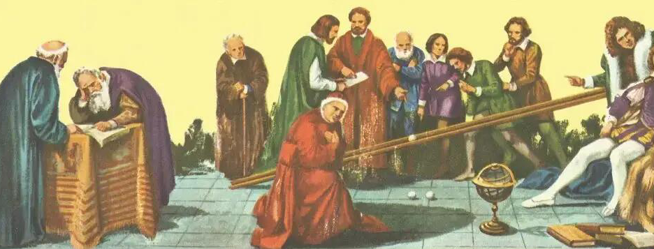

# Physics - 题目 1248

**ID**: c4e3d2e1c68041f1ac0afadf04666271
**年级**: Grade 10
**难度**: Easy
**题型**: Multiple-choice

## 题目
如图所示的油画描述了伽利略研究自由落体运动规律时设计的斜面实验。​​​​​​​‌他让铜球沿倾斜的长直轨道由静止开始运动，利用滴水计时的方法记录铜球运动的时间，研究铜球的运动规律。某小组同学重做此实验，让小球从倾角为θ的斜面顶端由静止滚下。下列判断正确的是（      ）

## 解答

1. A．斜面的倾角θ越大，小球运动的加速度越大，因为小球滚动时所受的滚动摩擦力一般远小于滑动摩擦力，可以认为几乎不变，但重力沿斜面向下的分力在增大，所以小球加速度增大，A错误；
2. B．小球质量不变，惯性不变，B错误；
3. C．斜面的倾角θ一定时，小球做初速度为0的匀加速直线运动，由位移时间关系
4. $x=\frac {1}{2}at{^{2}}$
5. 得到小球通过的位移与所用时间的二次方成正比，C正确；
6. D．斜面的倾角θ一定时，小球做初速度为0的匀加速直线运动， 由速度时间关系得
7. $v=at$
8. 小球运动到底端时的速度与所用时间成正比，D错误。
9. 故选C。

## 知识点

**中文**:
  - 匀变速直线运动的位移—时间公式及其应用
  - 匀变速直线运动的速度—时间公式及其应用
  - 惯性及其应用

**English**:
  - Displacement-Time Formula and Applications
  - Velocity-Time Formula and Applications
  - Inertia and its Applications

---
