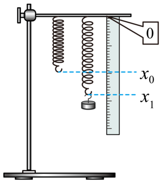

# Physics - 题目 1204

**ID**: cba7775f7b8f475285e8e34d71e5733f
**年级**: Grade 10
**难度**: Easy
**题型**: Multiple-choice

## 题目
用图示装置探究弹簧弹力与形变量的关系。​​​​​​​‌把弹簧上端固定在铁架台的横杆上，记录弹簧自由下垂时下端在刻度尺的位置 $x{{}_{0}}$ 。在弹簧下端悬挂质量为 $m$ 的钩码，待钩码静止时记录弹簧下端在刻度尺的位置 $x{{}_{1}}$ ，重力加速度为 $g$ ，则弹簧的劲度系数为（      ）

## 解答

1. 竖直悬挂时，根据胡克定律及受力平衡有 $mg=k(x{{}_{1}}-x{{}_{0}})$
2. 解得 $k=\frac {mg}{x{{}_{1}}-x{{}_{0}}}$
3. 选D。

## 知识点

**中文**:
  - 弹力的大小与胡克定律

**English**:
  - Magnitude of Elastic Force and Hooke's Law

---
