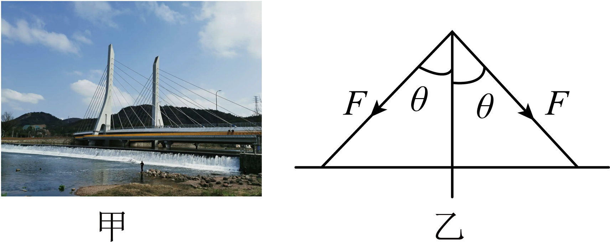

# Physics - 题目 384

**ID**: cead3ce301434b8e8d7494d2d6dc7ef3
**年级**: Grade 10
**难度**: Easy
**题型**: Multiple-choice

## 题目
如图所示为惠州的合生大桥，它在缓解交通压力、促进区域发展、美化城市景观等方面发挥了重要作用。​​​​​​​‌桥中某对钢索与竖直方向的夹角均为θ，如图乙所示，两根钢索的拉力大小均为F，则它们对塔柱的合力大小为（      ）

## 解答

1. 两根钢索的拉力大小均为F，则它们对塔柱的合力大小为
2. $F{{}_{合}}=2F{\cos}θ$
3. 故选C。

## 知识点

**中文**:
  - 求合力的常用方法及合力的取值范围

**English**:
  - Methods for Finding Resultant Force and its Range

---
