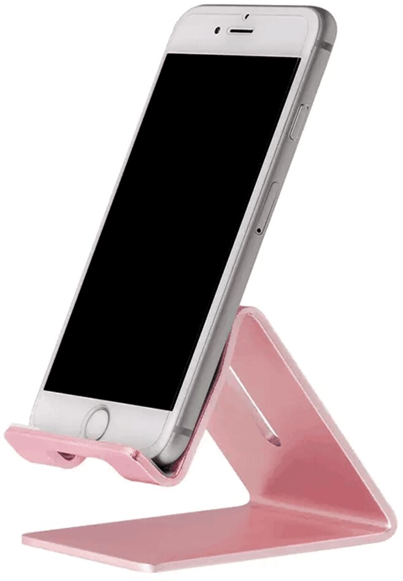

# Physics - 题目 2914

**ID**: d007a23e055747c2a6c323fc26df85b4
**年级**: Grade 10
**难度**: Easy
**题型**: Multiple-choice

## 题目
手机支架大大方便了我们对于手机的使用。​​​​​​​‌如图，把一个手机支架放在水平面上，则（      ）

## 解答

1. 手机支架对手机的力和手机对手机支架的力大小相等，方向相反，作用在同一直线上，作用于两个物体，所以是一对相互作用力，A错误；手机支架受到桌面对手机支架的弹力，是由于桌面的形变产生的，B错误；手机支架对手机的力，方向竖直向上，与手机重力等大反向，二力平衡，C错误，D正确。

## 知识点

**中文**:
  - 作用力、反作用力与一对平衡力的区别
  - 弹力
  - 受力分析

**English**:
  - Difference between Action/Reaction Pair and Equilibrium Forces
  - Elastic Force
  - Force Analysis

---
