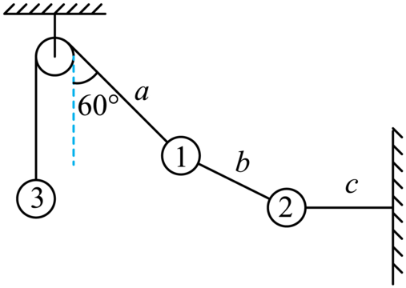

# Physics - 题目 1610

**ID**: d10c13bce0394c0abdc6999fa0a60226
**年级**: Grade 10
**难度**: Easy
**题型**: Multiple-choice

## 题目
如图所示,在竖直平面内用三根细线a、b、c将质量均为m的两个小球1和2连接，a的另一端跨过定滑轮与小球3相连并悬挂。​​​​​​​‌三小球处于静止状态，细线a与竖直方向的夹角为60°，细线c水平。不计滑轮与细线间摩擦。小球3的质量为（      ）

## 解答

1. 以小球3为对象，根据受力平衡可得 $T{{}_{a}}=m{{}_{3}}g$ ，以两个小球1和2为整体，根据受力平衡可得 $T{{}_{a}}{\cos}60{}\degree =2mg$ ，联立解得小球3的质量为 $m{{}_{3}}=4m$ ，选D。

## 知识点

**中文**:
  - 在共点力平衡中整体法与隔离法的应用
  - 正交分解法与三角形定则在平衡问题中的应用

**English**:
  - Whole and Isolation Methods in Equilibrium
  - Orthogonal Decomposition and Triangle Rule in Equilibrium

---
