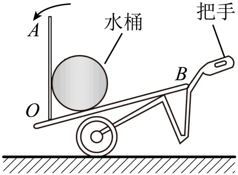

# Physics - 题目 2215

**ID**: d6ef0034dff94c42a850281e1eb9381b
**年级**: Grade 10
**难度**: Easy
**题型**: 单项选择题

## 题目
如图所示，送水工人用推车运桶装水，到达目的地后，工人抬起把手，带动板OA转至水平即可将水桶卸下。​​​​​​​‌若桶与接触面之间的摩擦不计， $∠AOB$ 为锐角，板OA、OB对水桶的压力大小分别为 $F{{}_{1}}$ 、 $F{{}_{2}}$ ，保持OB不动，使OA由竖直缓慢转到水平方向的过程中（      ）

## 解答

1. 使OA由竖直缓慢转到水平过程中，水桶受到的合力一直为0，保持不变，A错误；使OA由竖直缓慢转到水平的过程中，板OA对水桶的压力 $F{{}_{1}}$ 从水平向右逐渐变成竖直向上，以水桶为对象，其受力如图所示
2. 
3. 由图可知， $F{{}_{1}}$ 先变小后增大，与 $F{{}_{2}}$ 垂直时最小， $F{{}_{2}}$ 一直减小，BC错误D正确。选D。

## 知识点

**中文**:
  - 图解法在动态平衡问题中的应用

**English**:
  - Graphical Method for Dynamic Equilibrium

---
