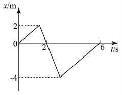

# Physics - 题目 823

**ID**: d89a322986a74fc899e929781559c034
**年级**: Grade 10
**难度**: Easy
**题型**: Multiple-choice

## 题目
如图所示是一物体的x-t图像，则该物体在6s内的位移是（      ）​​​​​​​‌

## 解答

1. 该图是位移图像，从图可知该物体在6s内的位移是0。
2. 故选A。

## 知识点

**中文**:
  - 认识x－t图像

**English**:
  - Understanding x-t Graphs

---
