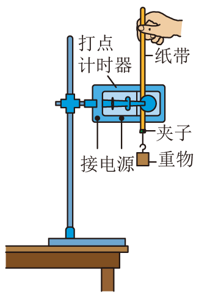

# Physics - 题目 812

**ID**: df9ba4545f184672a9f33fc78e905703
**年级**: Grade 10
**难度**: Easy
**题型**: Multiple-choice

## 题目
用打点计时器验证机械能守恒定律的实验装置如图所示。​​​​​​​‌下列说法正确的是（      ）

## 解答

1. 为了减小纸带与打点计时器之间的摩擦，打点计时器两个限位孔需要在同一竖直线上，A错误；由于验证机械能守恒的表达式中质量可以约去，所以不需要天平；实验中需要用刻度尺测量纸带上计数点之间的距离，B错误；不可以利用公式v=gt计算重物的速度，否则就失去了验证的意义，C错误；为了减小误差，测量下落高度时，选取的各点应距起始点适当远一些，D正确。

## 知识点

**中文**:
  - 实验：验证机械能守恒定律

**English**:
  - Experiment: Verifying Conservation of Mechanical Energy

---
