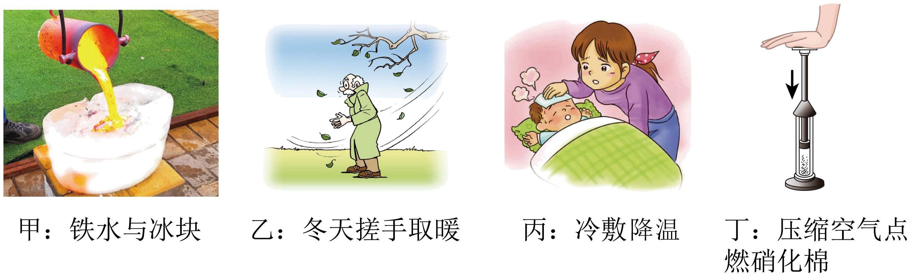

# Physics - 题目 2817

**ID**: e07f3659a86c496bbf1d878563558748
**年级**: Grade 10
**难度**: Easy
**题型**: Multiple-choice

## 题目
关于如图所示的热现象，说法正确的是（      ）​​​​​​​‌

## 解答

1. 不管物体温度高低，都具有内能，一切物体都具有内能，故A错误；冬天搓手取暖是通过做功的方式改变手的内能，此过程中将机械能转化为内能，故B错误；用湿毛巾冷敷降温，湿毛巾从人体吸收热量，使人体降温，内能减小，所以是通过热传递的方式减小人体的内能，故C错误；向下压活塞，对筒内空气做功，空气内能增加，温度升高，将机械能转化为内能；与汽油机压缩冲程能量转化相同，故D正确。

## 知识点

**中文**:
  - 热学

**English**:
  - Thermal Physics

---
