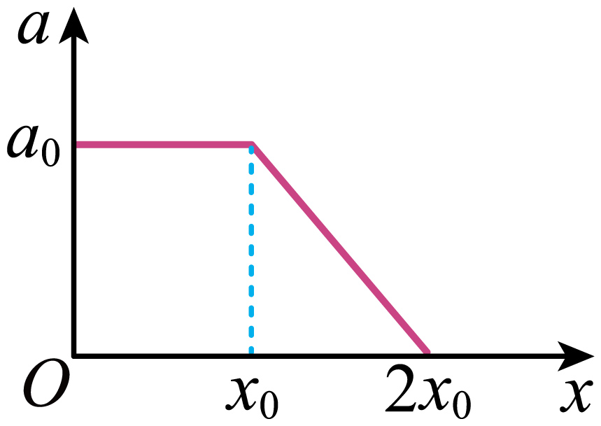

# Physics - 题目 908

**ID**: e8ae665fef4d4d21a6bdd8f25ab39398
**年级**: Grade 10
**难度**: Easy
**题型**: Multiple-choice

## 题目
一物体由静止开始运动，其加速度a与位移x关系图线如图所示。​​​​​​​‌下列说法正确的是（      ）

## 解答

1. 物体由静止开始运动，加速度先不变后变小，则物体先做匀加速直线运动，后做加速度减小的变加速直线运动，最终加速度为0，做匀速直线运动，故A错误；根据 $v{^{2}}=2ax$ ，得 $ax=\frac {v{^{2}}}{2}$ ，可知，加速度a与位移x关系图线与x轴所围的面积表示 $\frac {v{^{2}}}{2}$ ，当 $x=2x{{}_{0}}$ 时速度最大，设为 $v{{}_{m}}$ 。则得 $a{{}_{0}}x{{}_{0}}+\frac {1}{2}a{{}_{0}}x{{}_{0}}=\frac {v{{}_{{\rm{m}}}^{2}}}{2}$ ，解得 $v{{}_{{\rm{m}}}}=\sqrt {3a{{}_{0}}x{{}_{0}}}$ ，故BD错误，C正确。

## 知识点

**中文**:
  - 匀变速直线运动的速度与位移的关系

**English**:
  - Velocity-Displacement Relationship in UVRM

---
