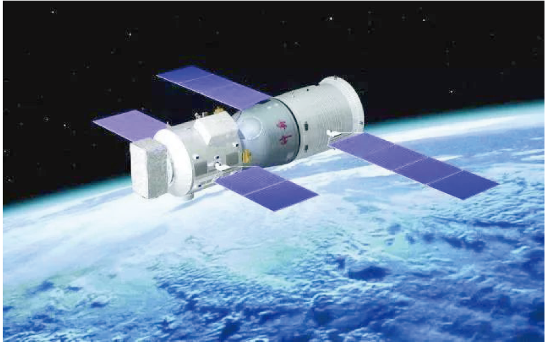

# Physics - 题目 388

**ID**: 5d39853df9354000b6f34615f0da5f0c
**年级**: Grade 10
**难度**: Easy
**题型**: Multiple-select

## 题目
从“嫦娥奔月”到“万户飞天”，从“东方红”乐曲响彻寰宇到航天员杨利伟遨游太空，中华民族载人航天的梦想已变成现实。​​​​​​​‌如图所示，“神舟”五号飞船升空后，先运行在近地点高度200千米、远地点高度350千米的椭圆轨道上，实施变轨后，进入343千米的圆轨道。假设“神舟”五号实施变轨后做匀速圆周运动，共运行了n周，起始时刻为t_{1}，结束时刻为t_{2}，运行速度为v，半径为r。则计算其运行周期可用（      ）

## 解答

1. 根据题意可知，“神舟五号”做匀速圆周运动运行n圈的时间为t_{2}-t_{1}，根据周期的定义得 $T= \frac {t{{}_{2}}-t{{}_{1}}}{n}{\rm ，A}$ 正确，B错误；根据周期与线速度的关系可得 $T=\frac {2πr}{v}{\rm ，C}$ 正确，D错误。

## 知识点

**中文**:
  - “火星凌日”问题

**English**:
  - 'Mars Transit' Problems

---
