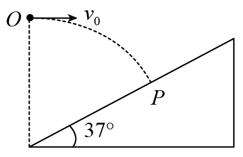

# Physics - 题目 2780

**ID**: c419379f1002418bbc752f265a07eb71
**年级**: Grade 10
**难度**: Easy
**题型**: Multiple-select

## 题目
如图所示，一个倾角为37°的斜面固定在水平面上，在斜面底端正上方的O点将一小球以速度v_{0}＝3 m/s水平抛出，经过一段时间后，小球垂直斜面打在P点处（小球可视为质点，不计空气阻力，取重力加速度g＝10 m/s^{2}，sin 37°＝0.​​​​​​​‌6，cos 37°＝0.8），则（      ）

## 解答

1. 小球的速度方向与斜面垂直，根据平行四边形定则有 ${\rm{t}}{\rm{a}}{\rm{n}}37{}\degree =\frac {v{{}_{0}}}{v{{}_{y}}}$ ，解得 $v{{}_{y}}=4{\rm{m}}/{\rm{s}}$ ，小球击中斜面时的速度大小 $v=\sqrt {v{{}_{0}^{2}}+v{{}_{y}^{2}}}=5{\rm{m}}/{\rm{s}}$ ，故A错误，B正确；小球运动的时间 $t=\frac {v{{}_{y}}}{g}=0.4{\rm{s}}$ ，可知水平位移 $x=v{{}_{0}}t=1.2{\rm{m}}$ ，竖直位移 $y=\frac {1}{2}gt{^{2}}=0.8{\rm{m}}$ ，故C错误，D正确。

## 知识点

**中文**:
  - 平抛运动与斜面、圆轨道相结合问题

**English**:
  - Horizontal Projectile on Inclined Planes and Circular Tracks

---
