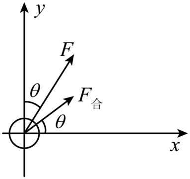

# Physics - 题目 1907

**ID**: cd3d2d1afda646c982c15e68724a5285
**年级**: Grade 10
**难度**: Easy
**题型**: Multiple-select

## 题目
投掷铅球刚要出手的瞬间，建立如图所示的直角坐标系，x轴、y轴分别沿水平方向和竖直方向，手对铅球的作用力F与y轴的夹角为θ，铅球受到的合力F_{合}与x轴的夹角也为θ，把F、F_{合}分别沿x轴、y轴分解，重力加速度为 ${\rm \mathit{g}，}{\cos}{^{2}}θ-\sin {^{2}}θ={\cos}2θ$ ，下列说法正确的是（      ）​​​​​​​‌

## 解答

1. x方向有 $F\sin θ=F{{}_{合}}{\cos}θ{\rm ，\mathit{y}}$ 方向有 $F{\cos}θ-mg=F{{}_{合}}\sin θ$ ，联立可得 $F{{}_{合}}=F{\tan}θ$ ， $m=\frac {F{\cos}2θ}{g{\cos}θ}$ ，选CD。

## 知识点

**中文**:
  - 正交分解法与三角形定则在平衡问题中的应用

**English**:
  - Orthogonal Decomposition and Triangle Rule in Equilibrium

---
