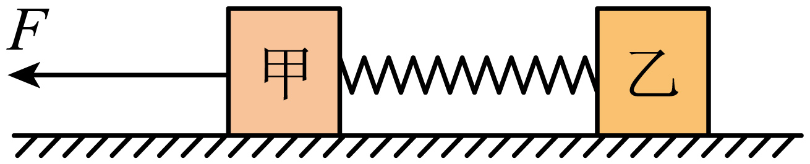

# Physics - 题目 789

**ID**: e106de777e434dfa901e48e9c078323c
**年级**: Grade 10
**难度**: Easy
**题型**: Multiple-select

## 题目
如图所示的水平面上，两滑块之间有一轻弹簧连接，弹簧伸长了5cm，滑块甲上作用有一水平向左的恒力F=8N，两滑块均处于静止状态。​​​​​​​‌已知滑块甲、乙的质量分别为 $m{{}_{1}}=2{\rm{k}}{\rm{g}}、$  $m{{}_{2}}=3{\rm{k}}{\rm{g}}$ ，两滑块与水平面间的动摩擦因数均为μ=0.2，弹簧的劲度系数为k=100N/m，重力加速度g取 $10{\rm{m}}{\rm{/}}{\rm{s}}{^{2}}$ ，假设最大静摩擦力等于滑动摩擦力。下列说法正确的是（      ）

## 解答

1. 弹簧弹力 $F{{}_{1}}=kx\mathrm{=}5{\rm{N}}$ ，滑块甲与地面间最大静摩擦力 $f{{}_{{\rm{m}}}}={\rm μm}{{}_{1}}g=4{\rm{N}}$ ，根据平衡可知，此时甲受到摩擦力作用，大小为 $f=F-F{{}_{1}}=3{\rm{N}}{\rm ，A}$ 正确B错误；撤去恒力F后瞬间，弹力大于甲的最大静摩擦力，甲受到滑动摩擦力，滑块甲所受的摩擦力大小为4N，而瞬间弹簧弹力未发生改变，乙受摩擦力与初态相同，仍为 $f^{′}=F{{}_{1}}\mathrm{=}5{\rm{N}}{\rm ，C}$ 正确D错误。

## 知识点

**中文**:
  - 弹力的大小与胡克定律
  - 静摩擦力有无的判定及静摩擦力的大小与方向
  - 滑动摩擦力的判断与计算

**English**:
  - Magnitude of Elastic Force and Hooke's Law
  - Determination of Static Friction (Existence, Magnitude, Direction)
  - Determination and Calculation of Sliding Friction

---
