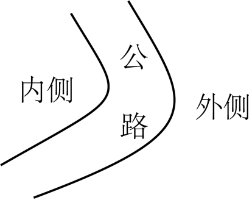

# Physics - 题目 2346

**ID**: e765c699370a4b2a869c6ba89a12e466
**年级**: Grade 10
**难度**: Easy
**题型**: Multiple-select

## 题目
如图，某公路急转弯处是一段圆弧，当汽车行驶的速率为 $v{{}_{0}}$ 时，汽车恰好没有向公路内外两侧滑动的趋势，则在该弯道处（      ）​​​​​​​‌

## 解答

1. 由于汽车恰好没有向公路内外两侧滑动的趋势，表明没有摩擦力，圆周运动的向心力由重力与支持力的合力提供，则路面外侧高、内侧低，A正确；令光路坡面的倾角为 $θ$ ，则有 $mg{\tan}θ=m\frac {v{{}_{0}^{2}}}{r}$ ，当车速低于 $v{{}_{0}}$ 时，汽车有向内侧滑动的趋势，地面对汽车有向外侧的静摩擦力作用，车辆并没有向内侧滑动，B错误；根据上述可以解得 $v{{}_{0}}=\sqrt {gr{\tan}θ}$ ，可知， $v{{}_{0}}$ 与结冰和未结冰没有关系，C错误；当车速高于 $v{{}_{0}}$ 时，但只要不超出某一限度，车辆不会向外侧滑动，但汽车有向外侧滑动的趋势，此时地面对汽车有指向内侧的静摩擦力作用，D正确。

## 知识点

**中文**:
  - 水平路面上车辆转弯问题

**English**:
  - Vehicle Turning on Level Roads

---
