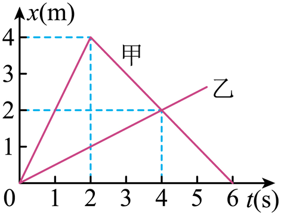

# Physics - 题目 2551

**ID**: f30ecba77c1f4b80845d6bb60c6d9401
**年级**: Grade 10
**难度**: Easy
**题型**: Multiple-select

## 题目
甲、乙两物体从同一点出发且在同一条直线上运动，它们的位移—时间 $(x-t)$ 图像如图，由图像可得（      ）​​​​​​​‌

## 解答

1. $x-t$ 图像斜率表示物体的速度， ${{4}}{\rm{s}}$ 末甲、乙两物体的速度大小不相等，故A错误； $4{\rm{s}}$ 时甲、乙两物体到达同一位置，相遇，故B错误； ${{0}}\sim {{4}}{\rm{s}}$ 两者位移相同，甲的平均速度等于乙的平均速度，故C正确；从图可以看出，甲物体 $0-2{\rm{s}}$ 内正向匀速运动， $2-6{\rm{s}}$ 反向匀速运动，乙物体一直正向匀速运动，故D正确。

## 知识点

**中文**:
  - x-t图像及其应用

**English**:
  - x-t Graphs and Applications

---
