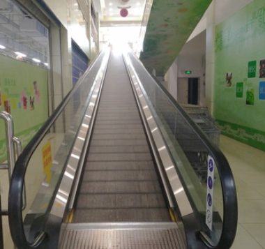

# Physics - 题目 528

**ID**: f3772d30a36b48b992585f7fddfeaa94
**年级**: Grade 10
**难度**: Easy
**题型**: Multiple-select

## 题目
大型商场或者大型超市为了方便顾客上下楼，都会安装自动扶梯。​​​​​​​‌如图是一种无台阶式扶梯，将扶梯运送顾客上楼的过程近似看作匀速直线运动，在这个过程中（      ）

## 解答

1. 重力的方向是竖直向下，故A错误；顾客所受弹力施力物体是扶梯，因此是由于扶梯的形变而产生的，故B正确；顾客随自动扶梯一起做匀速直线运动，二者相对静止，所受摩擦力为静摩擦力，故C错误；对顾客受力分析，顾客所受摩擦力方向沿扶梯向上，故D正确。

## 知识点

**中文**:
  - 受力分析
  - 弹性形变和弹力
  - 重力与重心
  - 静摩擦力有无的判定及静摩擦力的大小与方向

**English**:
  - Force Analysis
  - Elastic Deformation and Elastic Force
  - Gravity and Center of Gravity
  - Determination of Static Friction (Existence, Magnitude, Direction)

---
