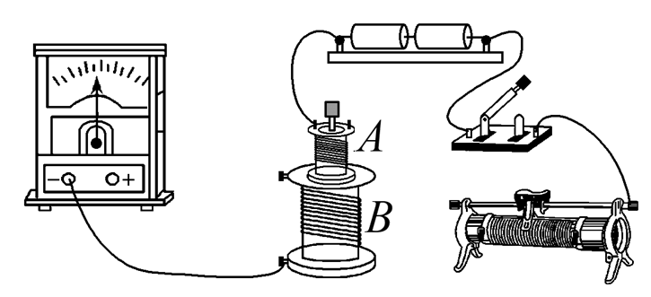

# Physics - 题目 670

**ID**: 284cf78832f54887bb3c5acb9ef9674d
**年级**: Grade 10
**难度**: Easy
**题型**: 达标练

## 题目
我们可以通过以下实验，来探究产生感应电流的条件(1)给岀的实物图中，请用笔画线代替导线补全实验电路。​​​​​​​‌(2)接好电路，闭合开关瞬间，电流表指针(选填“偏转”或“不偏转”)。(3)电路稳定后，电流表指针(选填“偏转”或“不偏转”)；迅速移动滑动变阻器的滑片，电流表指针(选填“偏转”或“不偏转”)。(4)根据以上实验可得：产生感应电流的条件是。

## 解答

1. (1)通过对电路分析可知：线圈B是用来检测感应电流的，故电流计要和线圈B构成闭合回路；滑动变阻器的作用是用来改变线圈A的电流大小，故要采取限流接法，综上所述，连线如图。
2. 
3. (2)接好电路，合上开关瞬间，由于线圈A中电流的变化，导致穿过线圈B的磁通量变化，从而使线圈B中产生感应电流，电流表指针偏转。
4. (3)电路稳定后，虽然线圈B中有磁场，但穿过线圈B的磁通量没有变化，不能产生感应电流，所以电流表指针不偏转。迅速移动滑动变阻器的滑片，由于线圈A中电流变化导致线圈B中磁通量的变化，从而使线圈B中产生感应电流，电流表指针偏转。
5. (4)根据(2)(3)可得，产生感应电流的条件是：穿过闭合导体回路磁通量发生变化。

## 知识点

**中文**:
  - 产生感应电流的条件

**English**:
  - Conditions for Induced Current

---
