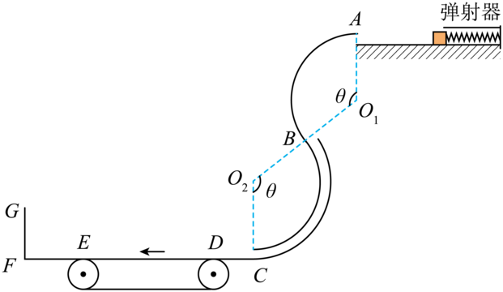

# Physics - 题目 137

**ID**: 5b0c698d988f42c3b8f1db54f9db4484
**年级**: Grade 10
**难度**: Hard
**题型**: Calculation

## 题目
如图所示，一弹射游戏装置由安装在水平平台上的固定弹射器和两个半径均为 $R=0.7{\rm{m}}$ 的“S”形圆弧轨道ABC、水平直轨道CD、EF、传送带DE以及竖直挡板FG组成，轨道各部分平滑连接。​​​​​​​‌ $O{{}_{1}}、O{{}_{2}}$ 为两圆弧轨道圆心， $O{{}_{1}}、O{{}_{2}}$ 连线与竖直线间的夹角均为 $θ=120{}\degree $ ，且A、C两点切线水平。传送带DE长度 $L=3{\rm{m}}$ ，速度 $v{{}_{0}}=10{\rm{m}}/{\rm{s}}$ 逆时针匀速转动。可视为质点的滑块质量 $m=1{\rm{k}}{\rm{g}}$ ，被弹射器由静止弹射，弹簧的弹性势能完全转化为滑块动能，滑块被弹射出去后从A点进入圆弧轨道，它与传送带之间的滑动摩擦因数 $μ=0.6$ ，其余各处均不计摩擦。滑块碰到挡板立即被粘住，游戏结束。（1）若滑块恰好不脱离“S”形圆弧轨道，求释放滑块时弹簧的弹性势能；（2）若滑块到达D点时速度 $v{{}_{1}}=8{\rm{m}}/{\rm{s}}$ ，求滑块通过传送带过程中，滑块与传送带产生的热量；（3）设弹簧被压缩后具有的弹性势能为 $E{{}_{{\rm{p}}}}$ ，其大小可随意调节，滑块撞击挡板前的瞬时速度为 $v$ 。在满足滑块不脱轨的前提下，求 $v$ 与 $E{{}_{{\rm{p}}}}$ 的函数关系。

## 解答

1. （1）滑块恰好不脱离圆弧轨道，在A处有 $mg=m\frac {v{^{2}}}{R}$
2. 根据能量守恒可得 $E{{}_{{\rm{p}}}}=\frac {1}{2}mv{^{2}}$
3. 联立解得 $E{{}_{{\rm{p}}}}=\frac {1}{2}mgR=3.5{\rm{J}}$
4. （2）滑块在传送带上匀加速时的加速度为 $a=\frac {{\rm μm}g}{m}=μg=6{\rm{m}}/{\rm{s}}{^{2}}$
5. 若滑块在传送带上一直匀加速，直到速度变为 $v{{}_{0}}=10{\rm{m}}/{\rm{s}}$ ，设运动时间为 $t$ ，根据运动学公式可得 $v{{}_{0}}=v{{}_{1}}+at$
6. 解得 $t=\frac {1}{3}s$
7. 滑行的位移为 $x=\frac {v{{}_{1}}+v{{}_{0}}}{2}t=3{\rm{m}}=L$
8. 即滑块加速到 $v{{}_{0}}=10{\rm{m}}/{\rm{s}}$ 时，刚好运动到E点，所以滑块相对传送带滑行的相对位移为 $Δx=v{{}_{0}}t-L=\frac {1}{3}{\rm{m}}$
9. 摩擦产生的热量为 $Q={\rm μm}g\cdot Δx=2{\rm{J}}$
10. （3）①若物体在传送带上一直加速，且到达E处时，速度刚好加速到 $v{{}_{0}}$ ，此时 $v{{}_{0}^{2}}-v{{}_{1}^{2}}=2aL$
11. 解得 $v{{}_{1}}=8{\rm{m}}/{\rm{s}}$
12. 此时最初的弹性势能为 $E{{}_{{\rm{p}}}}=\frac {1}{2}mv{{}_{1}^{2}}-mg\cdot 3R=11{\rm{J}}$
13. 当 $3.5{\rm{J}}⩽E{{}_{{\rm{p}}}}⩽11{\rm{J}}$ 时，物体在传送带上一直加速，根据能量守恒可得 $\frac {1}{2}mv{{}_{C}^{2}}=E{{}_{{\rm{p}}}}+mg\cdot 3R$
14. 解得 $v{{}_{C}^{2}}=2E{{}_{{\rm{p}}}}+42$
15. 根据运动学公式可得 $v{^{2}}-v{{}_{C}^{2}}=2aL$
16. 解得 $v=\sqrt {2E{{}_{{\rm{p}}}}+78}({\rm{m}}/{\rm{s}})$
17. ②若物体在传送带上一直减速，且到达E处时，速度刚好减速到 $v{{}_{0}}$ ，此时 $v{{}_{0}^{2}}-v{{}_{1}^{2}}=-2aL$
18. 解得 $v{{}_{1}}=\sqrt {136}{\rm{m}}/{\rm{s}}$
19. 此时最初的弹性势能为 $E{{}_{{\rm{p}}}}=\frac {1}{2}mv{{}_{1}^{2}}-mg\cdot 3R=47{\rm{J}}$
20. 当 $E{{}_{{\rm{p}}}}⩾47{\rm{J}}$ 时，物体在传送带上一直减速，此时 $v{{}_{C}^{2}}=2E{{}_{{\rm{p}}}}+42$ ， $v{^{2}}-v{{}_{C}^{2}}=-2aL$
21. 可得 $v=\sqrt {2E{{}_{{\rm{p}}}}+6}({\rm{m}}/{\rm{s}})$
22. ③当 $11{\rm{J}}⩽E{{}_{{\rm{p}}}}⩽47{\rm{J}}$ 时，物体在传送带上一定会达到与传送带共速的状态，即 $v=10{\rm{m}}/{\rm{s}}$ ；
23. 综上所述可知，当 $3.5{\rm{J}}⩽E{{}_{{\rm{p}}}}⩽11{\rm{J}}$ 时， $v=\sqrt {2E{{}_{{\rm{p}}}}+78}({\rm{m}}/{\rm{s}})$ ；当 $11{\rm{J}}⩽E{{}_{{\rm{p}}}}⩽47{\rm{J}}$ 时， $v=10{\rm{m}}/{\rm{s}}$ ；当 $E{{}_{{\rm{p}}}}⩾47{\rm{J}}$ 时， $v=\sqrt {2E{{}_{{\rm{p}}}}+6}({\rm{m}}/{\rm{s}})$ 。

## 知识点

**中文**:
  - 功能原理、能量守恒与曲线运动的综合

**English**:
  - Energy Conservation in Curvilinear Motion

---
