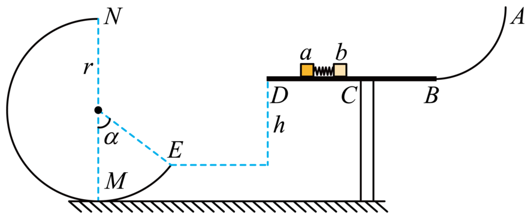

# Physics - 题目 2114

**ID**: 8b38773b56c54ea18314d813051c4f33
**年级**: Grade 10
**难度**: Hard
**题型**: Calculation

## 题目
如图所示，AB是半径 $R=0.8{\rm{m}}$ 的四分之一光滑圆弧轨道，其最低点B与水平桌面相切，水平面CD段光滑，BC段粗糙，BC段的长度 $L=2{\rm{m}}$ 。​​​​​​​‌桌面左侧竖直放置一光滑圆弧轨道EMN，其半径 $r=1{\rm{m}}$ ， $α=53{}\degree {\rm ，\mathit{MN}}$ 为竖直直径，E点到桌面的竖直距离 $h=0.8{\rm{m}}$ 。滑块a、b间的轻弹簧处于压缩状态并被锁定，滑块a、b静止在水平桌面CD之间，滑块a的质量 $m{{}_{1}}=2{\rm{k}}{\rm{g}}$ ，滑块b的质量为 $m{{}_{2}}$ （未知），滑块b与粗糙平面间的动摩擦因数为0.5。某时刻解除锁定，两滑块均在CD段内被水平弹出，滑块b恰好能到达A点，滑块a从水平桌面左侧端点D水平飞出恰好由E点无碰撞地落入圆轨道。滑块a、b均可视为质点，重力加速度g取 $10{\rm{m}}{\rm{/}}{\rm{s}}{^{2}}$ 。求：（1）弹簧被锁定时具有的弹性势能 $E{{}_{{\rm{P}}}}$ ；（2）滑块a到达圆轨道最低点M时对轨道的压力；（3）滑块a在圆轨道EMN上能到达的最高点与E点的水平距离x。

## 解答

1. （1）设滑块从D点抛出时的速度为 $v{{}_{1}}$ ，滑块抛出到E点，竖直方向上做自由落体运动，由运动学公式有 $h=\frac {1}{2}gt{^{2}}$ ，解得时间为 $t=0.4{\rm{s}}$ ，又有竖直方向速度为 $v{{}_{y}}=gt=4{\rm{m}}{\rm{/}}{\rm{s}}$ ，由几何关系可得 ${\tan}α=\frac {v{{}_{y}}}{v{{}_{1}}}$ ，解得 $v{{}_{1}}=3{\rm{m}}{\rm{/}}{\rm{s}}$ ，解除锁定后，设滑块b的速度为 $v{{}_{2}}$ ，小球b从C点到A点的过程中，由动能定理可得 $-{\rm μm}gL-mgR=0-\frac {1}{2}mv{{}_{2}^{2}}$ ，解得 $v{{}_{2}}=6{\rm{m}}{\rm{/}}{\rm{s}}$ ，解锁后滑块a、b水平方向动量守恒，规定向左为正方向，根据动量守恒定律， $m{{}_{1}}v{{}_{1}}-m{{}_{2}}v{{}_{2}}=0$ ，解得 $m{{}_{2}}=1{\rm{k}}{\rm{g}}$ ，从弹簧解锁前后，由能量守恒定律可得 $E{{}_{{\rm{p}}}}=\frac {1}{2}m{{}_{1}}v{{}_{1}^{2}}+\frac {1}{2}m{{}_{2}}v{{}_{2}^{2}}$ ，解得弹簧被锁定时具有的弹性势能为 $E{{}_{{\rm{p}}}}=27{\rm{J}}$ 。
2. （2）滑块a从E点到M点的过程中，由动能定理得 $m{{}_{1}}gr(1-{\cos}α)=\frac {1}{2}m{{}_{1}}v{{}_{M}^{2}}-\frac {1}{2}m{{}_{1}}v{{}_{E}^{2}}$ ，其中由几何关系 $v{{}_{E}}=\frac {v{{}_{y}}}{\sin 53{}\degree }=5{\rm{m}}{\rm{/}}{\rm{s}}$ ，代入解得 $v{{}_{M}}=\sqrt {33}{\rm{m}}{\rm{/}}{\rm{s}}$ ，在M点，由牛顿第二定律可得 $N-m{{}_{1}}g=m{{}_{1}}\frac {v{{}_{M}^{2}}}{r}$ ，解得 $N=86{\rm{N}}$ ，由牛顿第三定律可知，滑块对轨道的压力大小为 $N^{′}=N=86{\rm{N}}$ ，方向竖直向下。
3. （3）设以E点所在的水平面为参考平面，滑块a在光滑圆轨道中运动机械能守恒，在D点机械能为 $E{{}_{1}}=m{{}_{1}}gh+\frac {1}{2}m{{}_{1}}v{{}_{1}^{2}}$ ，解得 $E{{}_{1}}=25{\rm{J}}$ ，要能通过N点的临界速度满足 $m{{}_{1}}g=m{{}_{1}}\frac {v{{}_{临}^{2}}}{r}$ ，解得 $v{{}_{临}}=\sqrt {gr}=\sqrt {10}{\rm{m}}{\rm{/}}{\rm{s}}$ ，恰好能经过N点，在N点具有的机械能为 $E{{}_{2}}=\frac {1}{2}m{{}_{1}}v{{}_{临}^{2}}+m{{}_{1}}gr(1+{\cos}α)$ ，解得 $E{{}_{2}}=42{\rm{J}}$ ，所以 $E{{}_{1}}＜E{{}_{2}}$ ，又因为 $h＞r{\cos}α$ ，所以滑块a一定不能到达N点，到达与圆心等高位置P的速度大于零，如图所示，
4. 
5. 设滑块a到达圆轨道最高点为F点，F点与圆心的连线和竖直方向的夹角为 $β$ ，在F点速度为 $v{{}_{F}}$ ，由牛顿第二定律 $m{{}_{1}}g{\cos}β=m{{}_{1}}\frac {v{{}_{F}^{2}}}{r}$ ，滑块a从M点到F点的过程中，由动能定理可得 $-m{{}_{1}}gr(1+{\cos}β)=\frac {1}{2}m{{}_{1}}v{{}_{F}^{2}}-\frac {1}{2}m{{}_{1}}v{{}_{M}^{2}}$ ，根据几何关系有 $x=r\sin β+r\sin α$ ， ${\cos}{^{2}}β+\sin {^{2}}β=1$ ，联立可得 $x=\frac {24+\sqrt {731}}{30}{\rm{m}}$ 。

## 知识点

**中文**:
  - 应用动能定理求解多阶段、多过程问题

**English**:
  - Multi-stage/Multi-process Problems

---
