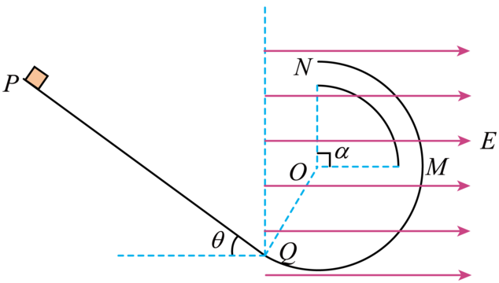

# Physics - 题目 1018

**ID**: e68400f49ef44d86b0a52d3ebe934049
**年级**: Grade 10
**难度**: Hard
**题型**: Calculation

## 题目
如图所示，倾角 $θ=37{}\degree $ 、长度L=3m的光滑绝缘斜面底端Q点与竖直光滑绝缘圆弧轨道QMN平滑连接，圆弧轨道的MN段为 $\frac {1}{4}$ 光滑管道（管道粗细远小于轨道半径且略大于物块尺寸），O为圆心，ON与OM分别为竖直和水平半径。​​​​​​​‌过Q点的竖直虚线右侧空间（包含虚线边界）存在水平向右的匀强电场，电场强度大小E=5×10^{5}V/m。一带电小物块（可视为质点）在斜面顶端P处由静止释放，已知小物块的质量 $m=\frac {4}{3}{\rm{k}}{\rm{g}}$ 、电量q=-2×10^{-5}C，整个过程中小物块电量始终保持不变，忽略空气阻力，重力加速度 $g=10{\rm{m}}{\rm{/}}{\rm{s}}{^{{{2}}}}$ ， $\sin 37\mathrm{°}=0.6$ ， ${\cos}37\mathrm{°}=0.8$ 。（1）求小物块第一次到达Q点时的速度大小；（2）若圆弧轨道半径R=0.9m，求小物块第一次经过Q点瞬间对圆弧轨道的压力大小；（3）要使小物块第一次沿圆弧轨道向上运动过程中，能进入MN段管道但不从N点飞出，求圆轨道半径R的取值范围。（结果可保留分数）

## 解答

1. （1）物块从 $P$ 到 $Q$ 由动能定理可知 $mg\sin θ\cdot L=\frac {1}{2}mv{{}_{Q}^{2}}-0$
2. 解得小物块第一次到达Q点时的速度大小为 $v{{}_{Q}}=6{\rm{m}}{\rm{/}}{\rm{s}}$ ；
3. （2）若圆弧轨道半径R=0.9m，小物块第一次经过Q点瞬间，受力分析受到重力、电场力和支持力，由径向合力提供向心力，有
4. $F{{}_{{\rm{N}}}}-mg{\cos}θ-qE\sin θ=m\frac {v{{}_{Q}^{2}}}{R}$
5. 由牛顿第三定律可知 $F{{}_{{\rm{N}}}}=F^{′}{{{}_{{\rm{N}}}}}$
6. 联立解得物块对圆弧轨道的压力大小为 $F^{′}{{{}_{{\rm{N}}}}}=70{\rm{N}}$ ；
7. （3）设电场力和重力的合力为 $G{^{^{′}}}$ ,其方向与竖直方向的夹角为 $β$ ，设此力为等效重力，则由勾股定理 $G^{′}=\sqrt {{\left({mg}\right)^{2}}+{\left({Eq}\right)^{2}}}=\frac {50}{3}{\rm{N}}$
8. 由几何关系 ${\tan}β=\frac {Eq}{mg}=\frac {3}{4}$
9. 即 $β=37{}\degree =θ$
10. 即 $Q$ 点为接下来做圆周运动的最低点，则过 $Q$ 点和圆心的反向延长线，交于圆周 $\mathrm{S}$ 点，为等效最高点；过圆心做直径 $QS$ 的垂线交于圆周于 $T$ 点，如图所示
11. 
12. 则由分析可知，当小物块第一次沿圆弧轨道到达 $T$ 点时，速度为零，小物块不脱离轨道也不从 $N$ 点飞出，由动能定理可知 $-G{^{^{′}}}R{{}_{1}}=0-\frac {1}{2}mv{{}_{Q}^{2}}$
13. 代入数据得 $R{{}_{1}}=\frac {36}{25}{\rm{m}}$ ，即圆轨道半径的取值范围为 $R{{}_{1}}⩾\frac {36}{25}{\rm{m}}$ ；
14. 由分析可知，当圆轨道半径较小时，小物块第一次沿圆弧轨道到到达 $\mathrm{S}$ 点时，速度为零，小物块不脱离轨道也不从 $N$ 点飞出，由动能定理可知 $-G{^{^{′}}}\cdot 2R{{}_{2}}=0-\frac {1}{2}mv{{}_{Q}^{2}}$
15. 代入数据得 $R{{}_{2}}=\frac {36}{50}{\rm{m}}$ ，即圆轨道半径的取值范围为 $R{{}_{2}}\mathrm{>}\frac {36}{50}{\rm{m}}$ ；
16. 假设第一次沿圆弧轨道到达 $M$ 点时,与轨道之间弹力为零，设此时速度为 $v{{}_{M}}$ ，则 $G{^{^{′}}}\sin β=m\frac {v{{}_{M}^{2}}}{R{{}_{2}}}$
17. 由动能定理可知 $-G^{′}{\left ({R{{}_{2}}+R{{}_{2}}\sin β}\right )}=\frac {1}{2}mv{{}_{M}^{2}}-\frac {1}{2}mv{{}_{Q}^{2}}$
18. 代入数据得 $R{{}_{2}}=\frac {144}{190}{\rm{m}}$
19. 即圆轨道半径的取值范围为 $\frac {36}{50}{\rm{m}}\mathrm{<}R{{}_{2}}\mathrm{<}\frac {144}{190}{\rm{m}}$ 。

## 知识点

**中文**:
  - 应用动能定理求解多阶段、多过程问题

**English**:
  - Multi-stage/Multi-process Problems

---
